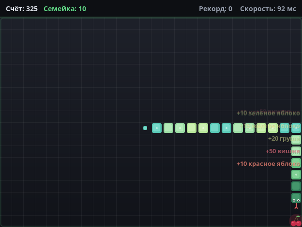

# zmeyka

Змейка на Java 17 + Swing: никаких внешних зависимостей, никакой Maven/Gradle-магии — только `javac`, `jar` и `jpackage`.

[Лицензия — MIT](LICENSE)



## Требования

Java 17+ (Swing/AWT). Для ELF-версии ставить Java не нужно — рантайм внутри.

## Запуск

**Собранный jar:**

```bash
java -jar zmeyka-1.0.jar
```

**Нативный ELF (Linux x86-64), из архива релиза:**

```bash
tar -xzf zmeyka-1.0-linux-x64.tar.gz
./zmeyka/bin/zmeyka
```

**Из исходников:**

```bash
./run.sh            # компилирует в build/classes и запускает
./run.sh --wrap --cols=40 --rows=28 --cell=20 --speed=120
```

## Управление

| Клавиши | Действие |
| --- | --- |
| стрелки / WASD | движение (на старте сразу начинают бег) |
| Пробел, Enter, P | старт / пауза |
| R | заново |
| Esc | выход |

## Правила

Угощение появляется по весам, каждое 5-е — гарантированно вишня.

| Фрукт | Очки | Рост | Вес |
| --- | --- | --- | --- |
| красное яблоко | 10 | +1 | 34 |
| зелёное яблоко | 10 | +1 | 22 |
| жёлтое яблоко | 15 | +1 | 16 |
| груша | 20 | +1 | 14 |
| вишня | 50 | +2 | 4 |

- Скорость растёт с каждым съеденным фруктом (−3 мс за тик, не быстрее 55 мс).
- Над съеденным фруктом всплывают очки и название, змейка высовывает язык, когда фрукт рядом.
- Столкновение со стеной или с собой заканчивает игру; с флагом `--wrap` стены пропускают змейку насквозь.
- Рекорд хранится локально в `~/.snake/highscore.properties`.

## Семейный окрас

Змейка раскрашена по членам семьи: каждые 2 сегмента — свой персонаж. Впереди Папа, за ним Мама, дальше дети (Малыш, Дочка, Сынок) по кругу. Границы между персонажами помечены светлой веснушкой, хвост сужается, в HUD счётчик `Семейка: N`, на старте показана легенда с именами и цветами.

## Параметры запуска

```
zmeyka [--wrap] [--cell=N] [--cols=N] [--rows=N] [--speed=MS] [--version] [--help]

  --wrap      проходить сквозь стены
  --cell=N    размер клетки в пикселях (24)
  --cols=N    ширина поля в клетках (30)
  --rows=N    высота поля в клетках (22)
  --speed=MS  стартовая задержка тика в мс (140)
```

## Сборка

```bash
./run-tests.sh   # 41 проверка логики, без GUI
./build.sh       # классы + проверки + build/libs/zmeyka-<версия>.jar
./package.sh     # build.sh + jpackage: ELF-лаунчер и урезанный JRE в build/dist/
```

`package.sh` делает `jpackage --type app-image` с `--add-modules java.base,java.desktop` и `--jlink-options "--strip-debug --no-header-files --no-man-pages --compress=2"`, затем упаковывает каталог в `build/dist/zmeyka-<версия>-linux-x64.tar.gz`. Версия берётся из `Version.NUMBER` — одна точка правки для окна, jar, tar.gz и тега релиза.

Внутрь архива попадает JRE того JDK, из которого взят `jpackage` из `PATH`; релизный архив собран на Temurin: `PATH=/path/to/temurin-17/bin:$PATH ./package.sh` (app-image ~54 МБ, tar.gz ~32 МБ).

## Структура

```
build.sh, package.sh, run.sh, run-tests.sh
LICENSE
docs/screenshot.png
src/main/java/com/dzolotarev/zmeyka/
  Main.java           — точка входа, параметры запуска, --version/--help
  Version.java        — версия выпуска
  GameFrame.java      — окно
  GamePanel.java      — ввод, таймер игрового цикла, отрисовка
  Game.java           — правила и состояние (без Swing, покрыто проверками)
  Snake.java          — тело + очередь поворотов
  Food.java           — угощение (клетка + вид фрукта)
  FruitKind.java      — яблоки/груша/вишня: цвета, очки, рост, вес появления
  FruitPicker.java    — взвешенный выбор фрукта + гарантированная вишня
  FamilyPalette.java  — имена и оттенки членов семьи
  BoardConfig.java    — размер поля, wrap-режим, скорость
  Cell.java           — клетка сетки
  Direction.java      — направления
  HighScoreStore.java — рекорд в properties-файле
src/test/java/com/dzolotarev/zmeyka/
  GameLogicTest.java  — 41 проверка: стены, wrap, самопересечение, рост, скорость, фрукты, окрас
```

Логика (`Game`, `Snake`, `FruitPicker`, `FamilyPalette`) намеренно отделена от Swing: `GamePanel` только рисует и передаёт события, весь игровой цикл идёт на EDT — гонок между вводом и таймером нет. Именно поэтому проверки запускаются headless, без JUnit и без сети.

## Релизы

| Версия | Что внутри | Ассеты |
| --- | --- | --- |
| [v1.0](https://github.com/dzolotarev/zmeyka/releases/tag/v1.0) | первый релиз: семейный окрас, яблоки/груши/вишня, всплывающие очки, `--version`/`--help` | [zmeyka-1.0.jar](https://github.com/dzolotarev/zmeyka/releases/download/v1.0/zmeyka-1.0.jar) (31 КБ), [zmeyka-1.0-linux-x64.tar.gz](https://github.com/dzolotarev/zmeyka/releases/download/v1.0/zmeyka-1.0-linux-x64.tar.gz) (32 МБ, ELF + JRE на базе Temurin) |

## Лицензия

MIT — см. [LICENSE](LICENSE). Можно использовать, изменять и распространять, включая коммерческое использование, с сохранением уведомления об авторстве.
